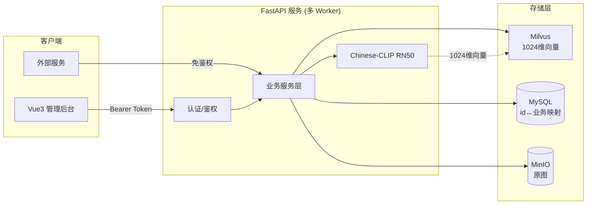

<div align="center">

# Image Search · Chinese-CLIP 图搜服务

**基于 Chinese-CLIP 的中文图文检索服务 · FastAPI + Milvus + MySQL + MinIO + Vue3**


[特性](#-核心特性) · [快速开始](#-快速开始) · [接口文档](#-api-一览) · [部署](#-部署) · [后台管理](#-web-管理后台) · [FAQ](#-常见问题)

</div>

---

## 项目简介

一个开箱即用的**中文图片搜索服务**：图像与文本统一编码到同一个 1024 维向量空间，支持「以图搜图」和「中文文本搜图」，相似度以百分比返回。

模型采用 [`OFA-Sys/chinese-clip-rn50`](https://huggingface.co/OFA-Sys/chinese-clip-rn50)（通过官方 `cn_clip` 包加载 `RN50`），原生支持中文，**无需外部翻译服务**。配套 Vue3 玻璃拟态风格的管理后台，覆盖图库、图片、上传、检索、用户、日志、备份、压测等全部运维功能。

<div align="center">

| 检索能力 | 工程特性 | 运维能力 |
|:---:|:---:|:---:|
| 🖼️ 以图搜图 | ⚡ 流式批量入库 | 👥 JWT 登录 + 两级权限 |
| 🈶 中文文本搜图 | 💾 离线权重优先 | ⏰ 定时备份图库 |
| 🎯 余弦相似度 | 🔌 单表统一 1024 维 | 📜 在线日志查看 |
| 🚀 轻量检索接口 | 🧠 多 Worker + 并发推理控制 | 📊 在线性能压测 |

</div>

---

## 📦 技术栈

| 层 | 技术 |
|---|---|
| 模型 | `cn_clip` · Chinese-CLIP RN50（图像/文本同源 1024 维） |
| 后端 | Python 3.9+ · FastAPI · Uvicorn/Gunicorn · Pydantic |
| 存储 | Milvus 2.x（向量）· MySQL（映射）· MinIO（原图） |
| 前端 | Vue 3 · TypeScript · Vite · Pinia · axios |
| 运维 | Docker / docker-compose · nginx · APScheduler（定时备份） |

---

## ✨ 核心特性

- **图文同空间检索**：图像与文本均由 Chinese-CLIP 编码为 1024 维归一化向量，图搜与文搜共用一张 Milvus 集合，余弦相似度（IP 度量）
- **原生中文**：中文查询直接 `tokenize`，去掉了旧版的外部翻译依赖
- **离线优先加载**：权重放在项目根 `ai-model/` 即离线读取，否则首次自动联网下载
- **灵活入库**：`save_to_minio=false` 可只入库特征不存原图；`manual-id` 接口支持外部指定主键
- **流式批量导入**：URL 列表 / 多文件 / 服务器目录三种方式，后台分块处理，**内存峰值与图片总数无关**
- **可追溯的异步任务**：`taskId` 贯穿进度查询与 `imgId` 映射回传，数百万条映射分页落盘读取
- **性能优化**：批量提特征 + 批量写库、集合与 `load` 缓存、MySQL 探活节流、gRPC 连接节流
- **安全可控**：JWT 登录（7 天有效）、admin/user 两级权限；**业务接口免鉴权**供其它服务直接调用，管理接口需鉴权
- **可运维**：按 cron 定时备份图库、日志按天切割（默认保留 10 天）、在线压测统计 QPS 与 P50/P99

---

## 🏗️ 系统架构



---

## 🚀 快速开始

### 1. 环境要求

- **Python 3.9 / 3.10**（需与 torch、cn_clip 版本兼容）
- **Node.js 18+**（仅前端开发/构建需要）
- 依赖服务：Milvus 2.x、MySQL、MinIO（可用 `docker-compose` 一键起全套）

### 2. venv 虚拟环境（Windows PowerShell）

```powershell
cd "f:\Desktop\开发\image_search"

# 创建虚拟环境（只需执行一次）
python -m venv venv
.\venv\Scripts\Activate.ps1

# 若提示"禁止运行脚本"，先执行：
# Set-ExecutionPolicy -Scope Process -ExecutionPolicy Bypass

# 安装依赖（下载慢可加 -i https://pypi.tuna.tsinghua.edu.cn/simple）
python -m pip install --upgrade pip
pip install -r src\requirements.txt
```

> `torch` / `cn_clip` 体积较大，首次安装耗时较长。

### 3. 准备模型权重

- 权重目录：项目根 `ai-model/`（可用 `MODEL_DIR` 覆盖）
- 已有权重（RN50 对应 `chinese_clip_rn50.pt`）→ 直接离线读取
- 无权重 → 首次调用自动联网下载到该目录
- **离线部署**：提前把权重文件放进 `ai-model/` 即可

### 4. 启动主程序

```powershell
cd src

# 开发模式（推荐，带热重载）
uvicorn main:app --host 0.0.0.0 --port 5000 --reload

# 生产模式见下方「部署」章节
```

启动成功后：

- Swagger 接口文档：<http://127.0.0.1:5000/docs>
- 健康检查：<http://127.0.0.1:5000/api/v1/health>

停止服务：`Ctrl + C`；退出虚拟环境：`deactivate`。

### 5. 启动前端（可选）

```powershell
cd src\web
npm install
npm run dev
# 访问 http://localhost:5191 ，Vite 已代理 /api 到后端 5000
```

---

## 📡 API 一览

统一前缀 `/api/v1`，统一返回结构 `{status, message, data}`。

> **鉴权范围**：图搜业务接口**全部免鉴权**，供其它服务直接调用；管理接口（用户管理、图库创建/删除、日志、备份、压测）需 `Authorization: Bearer <token>`；登录公开，`logout`/`me` 需登录。

<details>
<summary><b>🔐 认证与用户（点击展开）</b></summary>

| 方法 | 路径 | 说明 | 权限 |
|---|---|---|---|
| POST | `/auth/login` | 登录，返回 `accessToken`（7 天有效） | 公开 |
| POST | `/auth/logout` | 登出 | 登录用户 |
| GET | `/auth/me` | 当前用户信息 | 登录用户 |
| GET | `/users` | 用户列表 `?page=1&size=10` | admin |
| POST | `/users` | 新建用户 `{"username","password","role"}` | admin |
| PUT | `/users/{id}` | 改角色 / 启停 `{"role","isActive"}` | admin |
| PUT | `/users/{id}/password` | 重置密码 `{"password"}` | admin |
| DELETE | `/users/{id}` | 删除用户 | admin |

</details>

<details>
<summary><b>🖼️ 业务接口 · 免鉴权（点击展开）</b></summary>

| # | 方法 | 路径 | 说明 |
|---|---|---|---|
| 1 | GET | `/health` | 健康检查（模型 / Milvus / MySQL / MinIO 状态） |
| 2 | GET | `/tables` | 图库列表（名称 + 图片数） |
| 3 | POST | `/tables` | 创建图库 `{"table_name":"xxx","auto_id":true}` **（admin）** |
| 4 | DELETE | `/tables/{table}` | 删除图库；`?cascade=true` 连原图一起删 **（admin）** |
| 5 | GET | `/tables/{table}/stats` | 图片数量 |
| 6 | POST | `/tables/{table}/images` | 上传单张（`save_to_minio=false` 不落原图） |
| 7 | POST | `/tables/{table}/images/manual-id` | 手动指定 `milvus_id` 上传 |
| 8 | POST | `/tables/{table}/images/batch` | 批量上传（异步，返回 `taskId`） |
| 9 | GET | `/tasks/{taskId}/progress` | 批量任务进度 |
| 9a | GET | `/tasks/{taskId}/result` | 按 taskId 分页取 `(imgId ↔ 业务标识)` 映射 |
| 10 | POST | `/tables/{table}/import/directory` | 服务器目录导入（后台任务） |
| 11 | GET | `/tables/{table}/import/progress` | 导入进度 |
| 12 | POST | `/tables/{table}/search/image` | 以图搜图（含业务字段） |
| 13 | POST | `/tables/{table}/search/text` | 中文文本搜图（含业务字段） |
| 13a | POST | `/tables/{table}/search/image/lite` | 以图搜图（**轻量**·只返回 `imgId`+`similarity`） |
| 13b | POST | `/tables/{table}/search/text/lite` | 文本搜图（**轻量**·只返回 `imgId`+`similarity`） |
| 14 | GET | `/tables/{table}/images/{id}/content` | 获取原图（未落 MinIO 不可用） |
| 15 | GET | `/tables/{table}/images` | 分页列表 `?page=1&size=10` |
| 16 | DELETE | `/tables/{table}/images/{id}` | 删除单张 |
| 17 | DELETE | `/tables/{table}/images` | 一键清空图库 `?cascade=true` **（admin）** |

</details>

<details>
<summary><b>🛠️ 运维接口 · admin（点击展开）</b></summary>

| 类别 | 接口 |
|---|---|
| 日志 | `GET /logs` · `GET /logs/{name}?lines=200&level=ERROR` |
| 备份任务 | `GET/POST /backups/tasks` · `PUT/DELETE /backups/tasks/{id}` · `POST /backups/tasks/{id}/run` |
| 备份记录 | `GET /backups/history` · `GET/DELETE /backups/files/{name}` · `GET /backups/files/{name}/download` |
| 压测 | `POST /perf/tasks`（`scenario=batch_upload` 时带 `batch_size`）· `GET /perf/tasks/{id}/progress` · `GET /perf/tasks/{id}/result` · `GET/DELETE /perf/results` |

</details>

### 关键参数说明

- **相似度**：返回百分比字符串（如 `"95.50%"`），来自归一化向量的余弦相似度。
- **轻量检索** `/search/*/lite`：只返回 `{"imgId","similarity"}`、完全不访问 MySQL，适合外部服务高频调用。
- **`save_to_minio=false`**：只入库向量与业务映射，不存原图；检索正常，但取原图接口不可用。
- **批量上传**：
  - JSON：`{"items":[{"image_url":"...","commodity_id":"..."}],"save_to_minio":true,"auto_id":true}`
  - multipart：`files` 多文件 + `commodity_ids` 列表 + `save_to_minio`
  - 立即返回 `{"taskId":"...","total":N}`；用 `/tasks/{taskId}/progress` 轮询进度。
  - **取 milvus_id**：完成后调 `GET /tasks/{taskId}/result?page=1&size=100`，每项含 `index`（上传项序号）、`imgId`、`commodityId`、`customsParam`、`rawUrl`；映射按磁盘分片存储，数百万条也不常驻内存。
  - **内存设计**：接口层只接收 URL / 临时路径，后台按 `READ_BATCH_SIZE` 分块，现读→提特征→入库→释放；multipart 文件流式写临时目录，任务结束自动清理。
- **目录导入**：`{"dir_path":"/data/xxx","save_to_minio":true}`，后台分块处理，用 `/tables/{table}/import/progress` 轮询。

---

## ⚙️ 配置说明

`src/config.py` 中所有参数均支持环境变量覆盖（PowerShell 示例）：

```powershell
$env:MILVUS_HOST="你的Milvus地址"
$env:MYSQL_HOST="你的MySQL地址"
$env:MYSQL_PWD="你的MySQL密码"
$env:MINIO_HOST="你的MinIO地址"
$env:MODEL_DIR="模型权重目录"
$env:DEVICE="cpu"                 # 或 "cuda"
$env:ENCODE_BATCH_SIZE="64"       # 批量编码块大小
$env:DB_BATCH_SIZE="500"          # 批量入库块大小
$env:READ_BATCH_SIZE="128"        # 批量上传每批读取数（决定内存峰值）
$env:UPLOAD_PATH="本地临时图片目录"
$env:JWT_SECRET="一个随机的长字符串"  # 生产环境务必设置
$env:ADMIN_USER="admin"
$env:ADMIN_PASSWORD="请修改为强密码"
$env:TOKEN_EXPIRE_DAYS="7"
$env:LOG_RETENTION_DAYS="10"
$env:BACKUP_DIR="备份目录"
$env:BACKUP_RETENTION_DAYS="30"
```

| 变量 | 默认值 | 说明 |
|---|---|---|
| `VECTOR_DIMENSION` | `1024` | 向量维度，chinese-clip-rn50 固定 1024 |
| `METRIC_TYPE` | `IP` | 归一化后等价于余弦相似度 |
| `MODEL_NAME` | `RN50` | cn_clip 模型名 |
| `MODEL_DIR` | `<项目根>/ai-model` | 模型权重目录 |
| `NLIST` / `NPROBE` | `1024` / `16` | IVF_FLAT 索引参数 |
| `INFER_CONCURRENCY` | 见启动脚本 | 单 worker 并发推理数，与 worker 数**相乘**决定总并发 |
| `FLUSH_MODE` | `async` | 单张上传 flush 模式：`async` 延迟批量 / `sync` 逐张立即 |
| `FLUSH_THRESHOLD` | `100` | async 模式累计多少张触发一次 flush |
| `FLUSH_INTERVAL` | `2` | async 模式最长多少秒触发一次 flush |
| `MYSQL_PING_INTERVAL` | `30` | MySQL 探活间隔（秒） |
| `JWT_SECRET` | 内置默认 | JWT 签名密钥，生产环境必须改 |
| `ADMIN_USER` / `ADMIN_PASSWORD` | `admin` / 环境变量设置 | 初始管理员，务必通过环境变量设置密码 |
| `LOG_RETENTION_DAYS` | `10` | 日志保留天数 |
| `BACKUP_RETENTION_DAYS` | `30` | 备份文件保留天数 |

> **性能调参**：总并发推理路数 = `WORKERS × INFER_CONCURRENCY`。23 核机器推荐 `4 × 6 ≈ 24`，让并发与核数匹配；不要按核数单独调高 worker（会加载多份模型且总并发远超核数，P95 长尾变差）。用后台「性能检测」页压测 `search_image`/`search_text` 场景，观察 QPS/P95 并用 `top` 看 CPU 是否吃满。
>
> **内存调优**：启动脚本已设 `MALLOC_ARENA_MAX=4` + `PYTHONMALLOC=malloc`，用于抑制 glibc 多线程 arena
> 导致的 RSS 虚高（23 核机器默认 arena 可达上百个，每个都缓存已释放内存不归还 OS）。
> 若循环上传单张图片后 RSS 只涨不降，多半是内存池行为而非真泄漏——这些环境变量能显著压低 RSS。
>
> **单张上传吞吐优化**：默认启用延迟 flush（`FLUSH_MODE=async`）——不再每张图都 `collection.flush()`，
> 而是累计 `FLUSH_THRESHOLD`（默认 100）张或每 `FLUSH_INTERVAL`（默认 2 秒）统一 flush 一次，
> 吞吐可提升 5~20 倍。代价是**新上传图片最长 2 秒内不可检索**；服务关闭时自动兜底 flush 保证不丢数据。
> 若需"上传即可搜"，设 `FLUSH_MODE=sync` 切回逐张 flush。此外 MinIO 上传与模型推理已并行、
> URL 下载复用连接池。`health` 接口的 `data.flush` 可观察待 flush 数与累计次数。

---

## 🐳 部署

### 方式一：docker-compose（全套服务，推荐）

```bash
docker compose up -d
```

一键编排 Milvus / MySQL / MinIO / 接口服务 / attu，端口映射 `5000:8000`。

### 方式二：单容器 + 预装镜像（依赖服务已存在）

```bash
# 首次构建镜像
docker build -t tusou-api:4.0 .
# 之后每次启动（秒级，无需重复 pip install）
bash start-docker-fast.sh
# 或完整版：bash start-docker.sh
```

启动脚本采用 `--network host`，按实际环境修改脚本顶部的 `MILVUS_HOST` / `MYSQL_HOST` / `MINIO_HOST` / `MYSQL_PWD`，生产环境务必改掉 `JWT_SECRET` 和 `ADMIN_PASSWORD`。

### 方式三：前端独立部署（nginx）

```bash
cd src/web && npm run build     # 产物输出到 dist/web
```

将根目录 `nginx.conf` 部署到 nginx（按实际路径修改 `root` 指向 `dist/web` 绝对路径，确认 `/api/` 反代到后端），然后 `nginx -s reload`。

---

## 🖥️ Web 管理后台

位于 `src/web`，Vue3 + TypeScript + Vite，复刻 `deeplethe/solid-glass` 的玻璃拟态视觉风格（深空渐变 + 磨砂面板 + 柔和光晕）。

<div align="center">

| 菜单 | 功能 | 权限 |
|:---|:---|:---:|
| 系统概览 | 服务健康状态、图库数/图片数统计、图库分布 | 登录用户 |
| 图库管理 | 图库列表、新建、删除（级联选项）、设为当前 | admin |
| 图片管理 | 分页列表、缩略图、删除、大图预览、一键清空 | 登录/清空需 admin |
| 上传入库 | 单张 / 手动 ID / 批量（URL 或文件）/ 目录导入 + 进度 | 登录用户 |
| 图片检索 | 以图搜图、中文文本搜图、topk 调节、结果网格 | 登录用户 |
| 用户管理 | 用户列表、新建、改角色/启停、重置密码、删除 | admin |
| 系统日志 | 日志选择、按级别/行数过滤、自动刷新、级别着色 | admin |
| 定时备份 | 任务 CRUD/启停/立即执行、执行历史、备份下载/删除 | admin |
| 接口文档 | 所有接口路径/参数/鉴权/curl 示例，支持搜索与复制 | 登录用户 |
| 性能检测 | 场景/量级/并发配置、实时进度、QPS 与分位数图表 | admin |

</div>

> 后台「接口文档」页可供外部服务开发者查阅完整调用方式，无需翻 README。

---

## ⏰ 定时备份

图库可按 cron 定时备份，产物为 `backups/{图库}_{时间戳}.tar.gz`：

| 文件 | 说明 |
|---|---|
| `mysql.csv` | MySQL 映射表全量数据（UTF-8 BOM，Excel 可直接打开） |
| `milvus_ids.npy` | Milvus 向量主键数组（int64） |
| `milvus_vectors.npy` | 向量矩阵（float32，1024 维） |
| `minio_objects.txt` | MinIO 对象名清单（**不打包原图**） |
| `manifest.json` | 备份元数据（图库名、时间、维度、行数、度量方式） |

- **Cron**：标准 5 段 `分 时 日 月 周`，如 `0 2 * * *` 每天 2 点。
- **调度**：基于 APScheduler，多 worker 部署时用文件锁确保单进程执行。
- **保留**：每任务可设保留天数（默认 30），自动清理过期压缩包。

日志按天切割为 `src/logs/milvus-YYYY-MM-DD.log`，**默认只保留最近 10 天**（`LOG_RETENTION_DAYS` 可调），后台「系统日志」页可在线查看。

---

## 📁 目录结构

```
image_search/
├── ai-model/                 # 模型权重目录（离线优先）
├── src/
│   ├── main.py               # FastAPI 应用与全部接口
│   ├── service.py            # 业务逻辑：入库/检索/删除/导入
│   ├── auth.py               # 认证与用户管理（JWT/bcrypt）
│   ├── clip_model.py         # Chinese-CLIP 模型单例与特征编码
│   ├── milvus_helpers.py     # 向量库操作（集合/load 缓存）
│   ├── flush_manager.py      # 延迟 flush 管理器（阈值/定时/兜底）
│   ├── mysql_helpers.py      # MySQL 映射表操作（ping 节流）
│   ├── minio_helpers.py      # MinIO 对象存储操作
│   ├── log_reader.py         # 日志读取
│   ├── backup.py             # 定时备份调度与执行
│   ├── perf.py               # 性能压测引擎
│   ├── config.py             # 全部配置（环境变量覆盖）
│   ├── requirements.txt      # 后端依赖
│   └── web/                  # Vue3 前端后台
├── backups/                  # 定时备份文件
├── dist/web/                 # 前端构建产物
├── nginx.conf                # 前端部署配置
├── Dockerfile                # 接口服务镜像
├── start-docker.sh           # 启动脚本（在线装依赖）
├── start-docker-fast.sh      # 启动脚本（预装镜像）
└── docker-compose.yaml       # 全套服务编排
```

---

## ❓ 常见问题

<details>
<summary>点击展开 FAQ</summary>

1. **激活脚本报"禁止运行脚本"**：先执行 `Set-ExecutionPolicy -Scope Process -ExecutionPolicy Bypass`。
2. **torch / cn_clip 安装慢**：换国内镜像源，或先单独安装 torch。
3. **启动后连接失败**：检查环境变量、依赖服务是否启动、网络可达；用 `/api/v1/health` 看各服务状态。
4. **首次启动下载模型**：`ai-model` 无权重会联网下载，离线部署请预先放入。
5. **端口被占用**：换端口如 `--port 5001`，同步修改访问地址。
6. **依赖编码报错**：`requirements.txt` 为纯 ASCII；若遇 `UnicodeDecodeError` 先执行 `$env:PYTHONUTF8="1"`。
7. **从旧版升级**：旧版维度 2048（res2next50）/ 512（CLIP），新版 1024，**必须全量重新灌库**。
8. **管理页报 401 / 跳登录**：管理接口 token 过期（7 天）或被清除，重新登录；确认 nginx `/api/` 反代透传 `Authorization`。业务接口免鉴权不受影响。
9. **缩略图显示"无原图"**：该图用 `save_to_minio=false` 上传，只有向量没原图，属正常。
10. **首次登录账号**：用户名 `admin`，密码由 `ADMIN_PASSWORD` 环境变量设置（未设置时以占位符启动，必须先设置才能登录）。
11. **定时任务没执行**：确认任务启用、cron 正确；多 worker 时只有一个进程持锁，用「执行历史」确认。
12. **备份文件很大**：300 万图片向量约 12GB，备份耗时较长；原图默认不打包。
13. **循环调单张上传内存上涨**：已修复（pymilvus 重复 `connect()` 泄漏 gRPC 连接，现已加连接节流）。大批量入库建议改用批量接口或目录导入。
14. **性能压测**：后台「性能检测」页支持单张上传、批量上传、以图搜图、文本搜图四种场景，
    服务端执行，关闭页面不影响；上传场景按预计写入图片数提示。
    **批量上传压测**：`scenario=batch_upload`，`total` 为批数，`batch_size` 为每批张数（默认 500，可配），
    结果含 QPS（批/秒）、图片吞吐（张/秒）、每张平均耗时；实际写入图片数 = `total × batch_size`。

</details>

---

<div align="center">

### ☕ 支持作者

如果这个项目对你有帮助，欢迎打赏一杯咖啡。有问题也可以扫码加 QQ 联系。


**Made with ❤️ using Chinese-CLIP**

模型版权归 [OFA-Sys/Chinese-CLIP](https://github.com/OFA-Sys/Chinese-CLIP) 所有（Apache 2.0）

</div>
